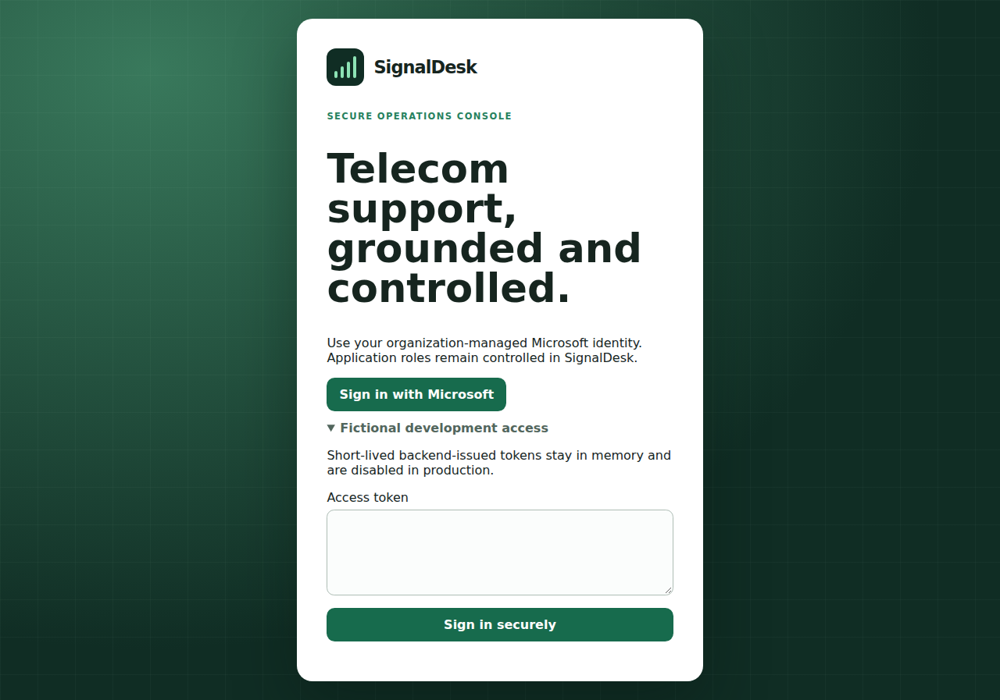
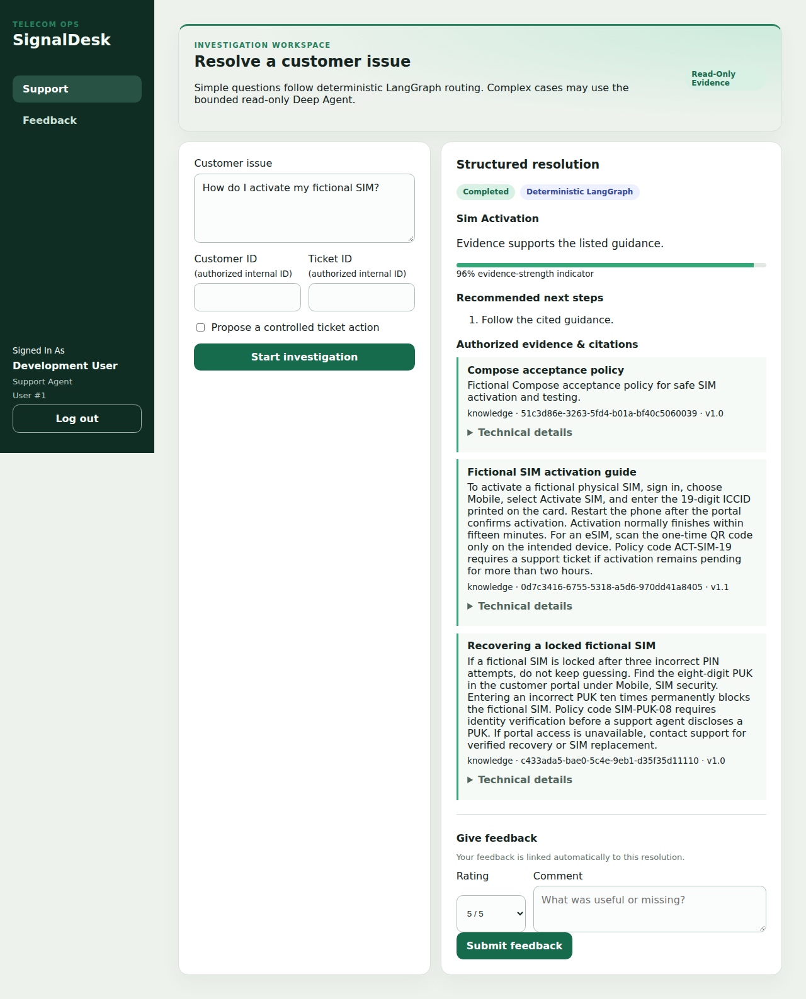
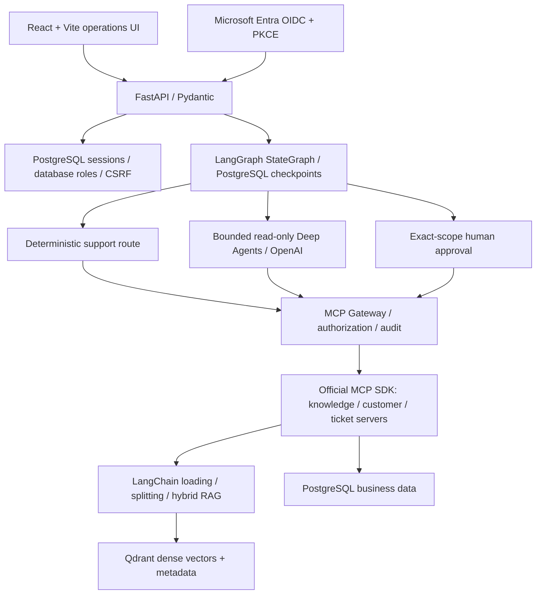
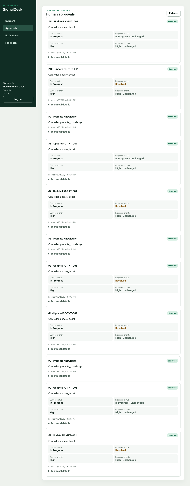
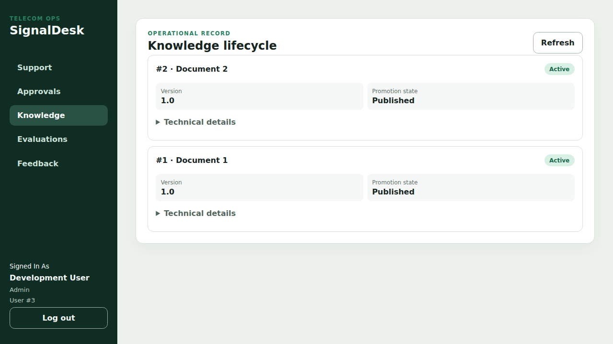
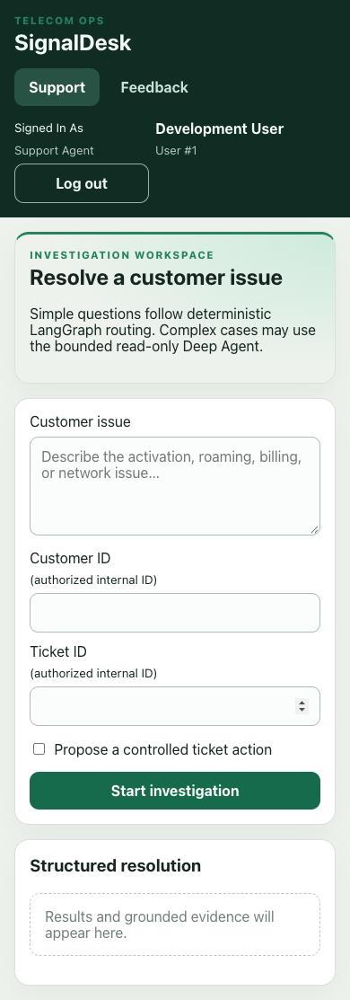

# SignalDesk

> **Source-review portfolio snapshot.** Not cleared for production deployment.
> Backend container findings remain unresolved and strict CI gates are retained.
> See [snapshot provenance](SNAPSHOT.md) and the
> [publication plan](docs/portfolio-publication-plan.md).

A telecom support operations workspace demonstrating controlled agent workflows,
grounded retrieval, and human approval before business changes. Built as an AI
Engineer portfolio project with fictional data, reproducible evaluation, and
explicit trust boundaries. This repository is independent of the earlier Telecom
RAG project. SignalDesk is the owner’s personal learning and portfolio project,
developed with OpenAI Codex assistance; it is not an employer or client project.

**Status:** Phases 0–16 implemented and validated; Phase 17 **IN PROGRESS**;
cloud deployment (18) and release acceptance (19) **PENDING**. This is a local
portfolio application, not a deployed production service.





## Why agentic AI

Support agents must reconcile knowledge, subscription state and ticket history
before recommending a resolution. SignalDesk models that cross-system work with
explicit routing, evidence contracts and human authorization for consequential
changes. Bounded investigation handles cases requiring multiple read tools;
simple requests take a reproducible deterministic path.

## Architecture



The model receives bounded read tools through the Gateway. It does not own
business write authority. Ticket writes and knowledge promotion require a
persisted, authorized, unexpired, single-use approval matching the exact action.
PostgreSQL coordinates recoverable Qdrant publication; checkpoint provisioning
and Alembic migrations are explicit setup jobs, never request-time operations.

The execution flow in `backend/app/workflow/graph.py` classifies the issue,
then selects retrieval/customer/ticket evidence gathering or a bounded Deep
Agents investigation. Both paths produce a strict structured resolution. A
proposed business action interrupts for approval; an authorized resume executes
through the Gateway, records an audit event and returns the final response.
These are specialized graph steps and a delegated investigation agent, rather
than independent autonomous agents with unrestricted write tools.

## Implemented engineering

- **Orchestration:** genuine asynchronous LangGraph routing and durable resume;
  deterministic simple support and official Deep Agents for bounded investigations.
- **RAG:** LangChain documents/splitting, deterministic telecom embeddings,
  BM25 + dense retrieval, reciprocal-rank fusion, cross-signal reranking,
  access/version filtering, citations and insufficient-evidence responses.
- **MCP:** official SDK servers behind a namespaced Gateway with database-bound
  roles, strict tool contracts, timeouts, bounded safe retries and audit events.
- **Human control:** approval/edit/reject, replacement authorization after material
  edits, row locking, action digests, replay prevention and idempotent execution.
- **Identity/security:** Microsoft Entra single-tenant Authorization Code + PKCE,
  hashed revocable server sessions, CSRF checks, database-owned roles, secure
  production cookies, PII redaction and fail-closed authorization. Real interactive
  Entra sign-in remains unverified; [setup](docs/authentication-entra.md).
- **Operations:** React role-aware support, approvals, knowledge, evaluations and
  feedback; correlation IDs, latency/usage/cost telemetry and recovery tooling.
- **Evaluation:** 40 fictional deterministic cases and explicit thresholds;
  optional bounded RAGAS/OpenAI evaluation. Historical genuine RAGAS results are
  recorded separately from offline metrics in the [tracker](docs/phase-tracker.md).
- **Delivery:** Docker Compose, separate runtime/evaluation images, GitHub Actions
  backend/frontend/migration/security/image/browser gates. Paid evaluation is
  manual opt-in. CI/CD currently supplies CI, with no cloud deployment automation.

## Local setup

Use Python 3.13, uv, Node.js 22 with npm, Docker Compose and Git. From this root:

```bash
uv sync --frozen --extra evaluation
npm --prefix frontend ci
cp .env.example .env
cp frontend/.env.example frontend/.env
```

Configure ignored secrets following [secrets/README.md](secrets/README.md).
Never put credentials in `VITE_` variables; those become browser-visible.

```bash
docker compose config --quiet
docker compose up -d --build --wait
docker compose --profile tools run --rm seed
```

Open <http://localhost:5173> (UI), <http://localhost:8000/docs> (API), and
<http://localhost:8000/ready> (readiness). Compose provisions migrations and
checkpoints. Its fictional development login is for local use only. Generate a
short-lived token locally with `docker compose exec -T backend python -m
backend.scripts.issue_development_token support_agent` and paste it into the
local login form; never share tokens or screenshots containing them.

For frontend development use `npm --prefix frontend run dev`; for host backend
setup and explicit database/knowledge initialization see the
[command reference](docs/command-reference.md) and
[Compose guide](docs/phases/phase-16-docker-compose.md).
Stop with `docker compose down`; preserve volumes. Never use `down -v` for
routine work. Do not reuse development databases for tests.

## Validation

Integration tests require the isolated PostgreSQL database `telecom_test_db`,
with schema already migrated to head. The fixture rejects other database names.

```bash
TEST_DATABASE_URL=postgresql+psycopg:///telecom_test_db uv run pytest backend/tests -q
uv run ruff check backend
uv run ruff format --check backend
uv run python -m backend.scripts.run_deterministic_evaluation
npm --prefix frontend run lint
npm --prefix frontend test
npm --prefix frontend run build
npm --prefix frontend run test:e2e
uv lock --check
```

Playwright requires Chrome and the fictional Compose stack; it exercises writes
and must run against isolated acceptance data. Stop conflicting local services
without removing volumes, then use this dedicated test configuration:

```bash
export COMPOSE_PROJECT_NAME=signaldesk-release-audit
export COMPOSE_FILE=compose.yaml:compose.acceptance.yaml
docker compose up -d --build --wait
docker compose --profile tools run --rm seed
npm --prefix frontend run test:e2e
docker compose down
unset COMPOSE_PROJECT_NAME COMPOSE_FILE
```

This configuration selects only `telecom_test_db`, creates separate volumes, and
disables provider credentials for browser acceptance. The full current evidence and
public-release blockers are in [the audit](docs/public-release-audit.md).
RAGAS requires the optional evaluation extra and explicit paid opt-in; the
production API image excludes RAGAS and diskcache. See [security](SECURITY.md).

## Screenshots

Captured from fictional local acceptance workflows; they demonstrate implemented
behavior, not cloud deployment or verified Microsoft sign-in.

| Approval control | Knowledge lifecycle | Mobile |
|---|---|---|
|  |  |  |

## Limitations and release boundaries

- Deterministic embeddings/reranking and answer synthesis are a reproducible
  baseline, not a production semantic embedding model or universal LLM generator.
- The 40-case dataset and two-case historical RAGAS run are small fictional
  benchmarks, not evidence of real telecom accuracy. RAGAS evaluates selected
  retrieved text as the response/reference; it is not full agent answer scoring.
- Prompt-injection controls are defense in depth, not proof of immunity.
- Lightweight readiness, local service assumptions, and the recorded Qdrant
  client/server compatibility warning require production review.
- The strict container gate currently fails on 46 HIGH backend Debian package/
  advisory rows (10 CVEs); the patched frontend has zero HIGH/CRITICAL findings.
  These unresolved OS advisories block production container release. A separate
  source-review portfolio route is proposed in the [publication plan](docs/portfolio-publication-plan.md);
  it does not clear these findings. See [SECURITY.md](SECURITY.md).
- Optional frozen RAGAS dependencies have documented advisories and a deprecated
  LangChain community import. They remain isolated from production.
- Branch protection for the private development repository is blocked by its
  current plan; protection for a future public portfolio remote is not configured. Phase 17
  stays IN PROGRESS; Vercel/Render/managed PostgreSQL/Qdrant Cloud deployment and
  final Phase 19 acceptance remain PENDING.
- Historical artwork is verified Vite starter material with its upstream notice
  retained. Historical personal commit emails and Actions artifacts belong to the
  private development repository and are not included in this independent snapshot.
  Public source review requires explicit owner approval; production release remains blocked.

## Repository guide and rights

`backend/app/` contains API, orchestration, MCP, knowledge, identity and evaluation
services; `backend/tests/` regression tests; `frontend/` the React application;
`docs/phases/` implementation evidence; `.github/workflows/` CI definitions.

Read [CONTRIBUTING.md](CONTRIBUTING.md), [asset/data provenance](docs/provenance.md),
and the [publication checklist](docs/publication-checklist.md). No MIT, Apache or
other broad open-source license is granted for this project's original work.
Public visibility does not itself grant broad reuse rights; dependency licenses
remain their respective owners' terms.
